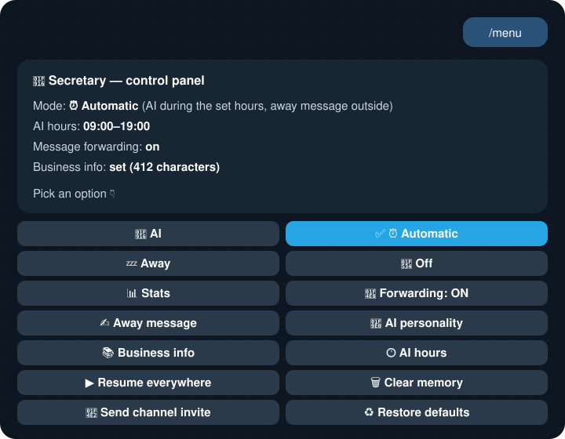
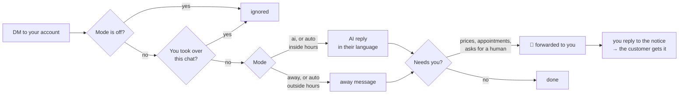

<p align="center">
  
</p>

<p align="center">
  
  
  
  
  
</p>

<p align="center">
  <b>Your Telegram account, answered even when you're not looking.</b><br />
  The bot plugs into <i>Settings → Chat Automation</i> and replies to your private chats in your name:<br />
  an AI that knows your business, a fixed away message, or nothing at all, on a schedule you choose.
</p>

<p align="center">
  <a href="#-quick-start"></a>
  <a href="./SETUP.md"></a>
</p>

---

## 💬 What it does

| | |
|---|---|
| 🤖 **Replies for you** | An AI assistant answers in your name, in the language the person writes in, matching their tone: playful with friends, professional with customers. |
| 📚 **Knows your business** | Give it your hours, address, price list and FAQ: it answers from those facts and never makes things up about you. |
| 📨 **Knows when to stop** | Prices, appointments, complaints, or someone who asks for a human: it reassures them and **forwards the chat to you**. |
| ↩️ **You answer from one place** | Reply to the forwarded notice and your text reaches the customer. The bot steps aside on that chat while you talk. |
| 🎙️ **Hears voice notes** | Transcribed on your own machine (no external API, no per-use cost) and answered like text. |
| 🕐 **Works your hours** | AI during the hours you set, a fixed away message outside them, or off. |

It runs as one Docker container on a NAS or a small VPS, with its state in a JSON file. No database, no cloud dashboard.

## 🎛️ The control panel

Everything is set from Telegram itself. Open a chat with your bot and send **`/menu`** (or `/start`, which adds a short welcome): you get a panel of buttons, no commands to remember.

<p align="center">
  
</p>

> The panel is in Italian, like its author. Here is what each button does.

### 🕹️ Modes (top four buttons)

The active mode has a ✅. Tap another one to switch.

| Button | Mode | What the bot does with an incoming DM |
|---|---|---|
| 🤖 **AI** | `ai` | Always answers with the AI. |
| ⏰ **Automatico** | `auto` | AI during the hours set in 🕐 *Orari AI*, away message outside them. |
| 💤 **Assenza** | `away` | Always sends the fixed away message. |
| 🔴 **Spento** | `off` | Ignores every message. |

### ⚙️ Settings

| Button | Meaning | What it does |
|---|---|---|
| 📊 **Statistiche** | Stats | AI and away replies, forwards, your relayed answers, channel invites, paused chats, connection status. |
| 📨 **Inoltro: ON/OFF** | Forwarding | Turns forwarding of important messages to you on or off. |
| ✍️ **Messaggio assenza** | Away message | Shows the current text. Type the new one as your next message (❌ *Annulla* to cancel). |
| 🧠 **Personalità AI** | AI personality | The instructions the AI follows: who you are, the tone, what not to promise. Type the new one; changing it clears the conversation memory. |
| 📚 **Info attività** | Business info | The knowledge base: ✏️ *Modifica* to edit it, 🗑 *Svuota* to clear it. |
| 🕐 **Orari AI** | AI hours | ✏️ *Imposta fascia*, then type e.g. `09:00-19:00` (windows across midnight work), or ♾ *Sempre attivo*. |
| ▶️ **Riattiva ovunque** | Resume everywhere | Lifts every pause, so the bot answers again in chats you had taken over. |
| 🗑 **Cancella memoria** | Clear memory | Forgets all conversations (asks for confirmation). |
| 📢 **Invia invito al canale** | Send channel invite | Sends your channel's invite to a customer: type their `chat_id`. Only shown when a channel is configured. |
| ♻️ **Ripristina default** | Restore defaults | Puts back the default away message and personality (asks for confirmation). |

### 📨 When a message is forwarded to you

You get a **📨 Messaggio da inoltrare** notice in the bot chat: who wrote, what they said, what the bot answered.

- **Reply to that notice** and your text goes straight to the customer, from your account.
- The bot then stays **silent in that chat for 30 minutes** (`HANDOFF_PAUSE_SECONDS`), so it never talks over you. The same happens when you type in the chat yourself. Each message you send restarts the timer.
- To bring it back earlier, tap **▶️ Riattiva il bot qui** under the confirmation, or ▶️ *Riattiva ovunque* in the panel.

<details>
<summary>⌨️ <b>Slash commands</b> (shortcuts, for those who prefer typing)</summary>

| Command | Effect |
|---|---|
| `/menu` | Open the control panel (`/impostazioni`, `/pannello` work too) |
| `/status` | Current state, connection, mode, stats |
| `/mode off\|away\|ai\|auto` | Switch mode |
| `/away <text>` | Change the away message |
| `/prompt <text>` | Change the AI personality |
| `/kb <text> \| clear` | Set or clear the knowledge base (`/faq` is an alias) |
| `/schedule HH:MM-HH:MM \| off` | Hours when `auto` mode uses the AI |
| `/forward on\|off` | Forward important messages to you (default `on`) |
| `/pause <chat_id>` | Silence the bot on one chat, like a takeover |
| `/resume [chat_id]` | Un-pause one chat, or all of them |
| `/promo <chat_id>` | Send the channel invite to a chat (also as a reply to a forwarded notice) |
| `/reset_history [chat_id]` | Clear conversation memory, for one chat or all |
| `/defaults` | Restore the default away message and personality |

</details>

## 🔀 How a message flows



## ✨ Features

- 🤖 **Two AI backends**: your Claude Max subscription via OAuth (no extra cost) or a pay-per-use API key.
- 🗣️ **Social smarts**: knows the sender's Telegram name, reads jokes and sarcasm instead of taking them literally, takes crude banter in stride without repeating it, and never invents facts about you or about the conversation.
- 🌍 **Replies in the sender's language**: the bot's own lines (channel invite, forward ack) follow it too.
- 📎 **Photos and documents**: it can't read them, so it acknowledges the customer and hands the attachment to you.
- ⌨️ **Typing indicator** while the AI writes, so the wait feels natural.
- 🧠 **Per-chat memory** that survives restarts, pruned after `HISTORY_TTL_DAYS` of silence.
- 📢 **Channel promo** (optional): a button with your channel's invite link under the first reply in each chat, at most once every `PROMO_COOLDOWN_DAYS`.
- 🛡️ **Anti-spam**: per-chat reply and forward cooldowns, long messages split at Telegram's limit, long voice notes handed off instead of hogging the CPU.
- 🧩 **Extensions**: add your own handlers without forking (see below).
- 🩺 **Health check**: a heartbeat file for Docker's `HEALTHCHECK`.

## 🚀 Quick start

1. **Create the bot**: `@BotFather` → `/newbot` → copy the token.
2. **Allow automation**: `/mybots` → your bot → **Bot Settings** → **Chat Access Mode** → **ON**.
3. **Find your user id** with `@userinfobot`.
4. **Get an AI credential**, on your own computer (a browser opens for the login):
   ```sh
   npm install -g @anthropic-ai/claude-code
   claude setup-token
   ```
   or use an API key with `CLAUDE_BACKEND=api`.
5. **Configure and start**:
   ```sh
   git clone https://github.com/emanueletech/telegram-ai-secretary.git
   cd telegram-ai-secretary
   cp .env.example .env      # fill BOT_TOKEN, OWNER_USER_ID and the AI credential
   mkdir -p data && sudo chown -R 1000:1000 data
   docker compose up -d --build
   ```
6. **Connect it**: in Telegram, **Settings → Chat Automation** → add your bot and allow **Reply to messages**.
7. Send **`/menu`** to your bot. Done.

The [full setup guide](./SETUP.md) covers NAS and VPS installs, deploying from your laptop with `scripts/deploy.sh`, backups, and every gotcha met along the way.

## ⚙️ Configuration

Everything lives in `.env`; [`.env.example`](./.env.example) is the annotated list. The ones you are most likely to touch:

| Variable | Default | Purpose |
|---|---|---|
| `BOT_TOKEN` | — | Bot token from `@BotFather` (required) |
| `OWNER_USER_ID` | — | Your Telegram user id: receives the panel and the forwards (required) |
| `CLAUDE_BACKEND` | `agent_sdk` | `agent_sdk` (subscription via OAuth) or `api` (API key) |
| `CLAUDE_CODE_OAUTH_TOKEN` | — | OAuth token for `agent_sdk` (`claude setup-token`) |
| `ANTHROPIC_API_KEY` | — | API key for `api` (leave empty with `agent_sdk`) |
| `AGENT_SDK_MODEL` | `sonnet` | Model for `agent_sdk`: `sonnet`, `opus`, `haiku` or a full id |
| `CLAUDE_MODEL` | `claude-haiku-4-5-20251001` | Model for `api` |
| `CLAUDE_MAX_TOKENS` | `400` | Max length of a reply |
| `HANDOFF_PAUSE_SECONDS` | `1800` | How long the bot stays quiet after you step in |
| `HISTORY_TTL_DAYS` | `7` | Days of silence before a chat's memory is dropped |
| `WHISPER_ENABLED` | `1` | `0` ignores voice notes |
| `WHISPER_MODEL` | `base` | `tiny`, `base`, `small`, `medium`, `large-v3` |
| `WHISPER_LANGUAGE` | _(auto)_ | Force a language (e.g. `it`) for short clips |
| `VOICE_MAX_SECONDS` | `300` | Longer voice notes go to you instead of being transcribed (`0` = no limit) |
| `PROMO_CHANNEL_URL` | _(empty)_ | Channel invite link for the promo button (empty = feature off) |
| `PROMO_BUTTON_TEXT` | `📢 Canale Telegram` | Label of the promo button |
| `PROMO_CHANNEL_DESCRIPTION` | _(empty)_ | What the channel is about, so the AI can answer questions on it |
| `PROMO_APPEND_TEXT` / `PROMO_APPEND_TEXT_EN` | _(generic)_ | Invite line under the reply: Italian chats / any other language |
| `PROMO_MANUAL_TEXT` | _(generic)_ | Text sent with the button by `/promo` |
| `PROMO_COOLDOWN_DAYS` | `30` | Minimum days between two invites to the same chat |
| `TZ` | `Europe/Rome` | Time zone used by the AI hours |

A few behaviours are constants in `app/config.py`: reply cooldown per chat (8 s), forward cooldown (5 min), memory length (12 turns), incoming text cap (3000 characters).

## 🧩 Extensions & private overlay

Need something only your deployment wants, like a custom `/start <payload>` flow or an extra command? Don't fork: drop a module into `app/extensions/`.

At startup `bot.py` loads every `app/extensions/*.py` (names starting with `_` or `.` are skipped) and calls its `register(app)`, **before** the built-in handlers. Within a handler group the first match wins, so an extension can claim `/start mypayload` while a plain `/start` still opens your panel. A failing extension is logged and skipped, never fatal. Extra Python dependencies go in `app/extensions/requirements.txt`, which the Dockerfile installs when present. Start from [`app/extensions/_example.py`](./app/extensions/_example.py).

To keep those modules, and your personal settings, out of a public fork, keep them in a private folder laid out like the deploy directory and pass it to `scripts/deploy.sh` as `OVERLAY=`:

```
my-private-config/
  app/extensions/my_feature.py        copied into the image
  app/extensions/requirements.txt     its dependencies
  personal.env                        non-secret personal settings
  docker-compose.override.yml         loads personal.env after .env
```

`docker compose` merges `docker-compose.override.yml` by itself, so two lines are enough:

```yaml
services:
  telegram-ai-secretary:
    env_file: [.env, personal.env]
```

Secrets (bot token, AI credentials, keys) stay in `.env` on the server only.

## 🗂️ Architecture

```
app/
  bot.py         entrypoint, handler wiring, extension loader, heartbeat
  config.py      env vars and tunable constants
  handlers.py    business messages, control panel, owner commands, DM relay
  ai.py          AI backends, per-chat memory, internal markers
  state.py       JSON state in data/state.json: mode, schedule, pauses, stats
  transcribe.py  on-device voice transcription (faster-whisper)
  extensions/    optional per-deployment modules
scripts/
  deploy.sh      update the clone, copy to the server, rebuild, show the logs
```

The AI signals decisions with internal markers that are stripped before anything reaches the customer: `[[FORWARD]]` to hand the chat to you, `[[LANG:xx]]` for the language it replied in. Telegram updates used: `business_connection`, `business_message`, `edited_business_message`, `deleted_business_messages`, plus `message` and `callback_query` for the panel. *Chat Automation* is what Telegram called *Business* until May 2026, when it stopped requiring Premium.

## 👤 Credits

Made by **Emanuele Esposito** · [Emanuele Tech](https://github.com/emanueletech).

Voice transcription by [faster-whisper](https://github.com/SYSTRAN/faster-whisper), Telegram API by [python-telegram-bot](https://github.com/python-telegram-bot/python-telegram-bot).

## 📄 License

[PolyForm Noncommercial 1.0.0](./LICENSE): free for any noncommercial use (personal, educational, research, hobby). Commercial use is not permitted.

<p align="center"><sub>⭐ If it saves you a few replies a day, a star helps others find it.</sub></p>
